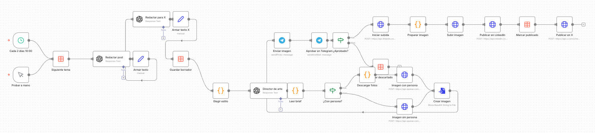
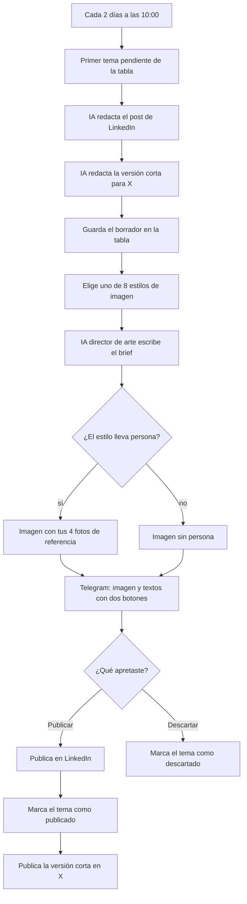

# Autopost LinkedIn + X con aprobación por Telegram

Una automatización para n8n que escribe y prepara una publicación para LinkedIn y otra más corta para X cada dos días, y te la manda a Telegram para que tú decidas si sale o no. Nada se publica sin que aprietes el botón de publicar.

n8n es un programa para armar automatizaciones uniendo bloques, sin tener que programar. Este repositorio trae los dos flujos de trabajo (en n8n se llaman workflows) listos para importar, una tabla de ejemplo y las instrucciones para dejarlo funcionando.



Así se ve por dentro. Cada bloque es un paso y se leen de izquierda a derecha: elegir el tema, redactar, crear la imagen, pedir tu aprobación por Telegram y publicar.

## Qué hace

Cada dos días, a las 10:00:

1. Toma el primer tema que esté en estado `pendiente` en una tabla dentro de n8n.
2. Una inteligencia artificial de OpenAI (el modelo gpt-5.5) redacta el post de LinkedIn con el estilo de escritura que definas, y después una versión corta para X que resume la misma idea.
3. Guarda el texto en la tabla como `borrador`.
4. Elige uno de 8 estilos de imagen. Algunos llevan tu cara y otros no.
5. Una segunda IA, que hace de director de arte, escribe las instrucciones de la imagen: titular, colores y composición.
6. Se genera la imagen con gpt-image-2. Si el estilo lleva persona, usa 4 fotos tuyas como referencia para que la cara se parezca a ti.
7. Te llega a Telegram la imagen y los dos textos, con dos botones: publicar o descartar.
8. Si apruebas, sube la imagen y publica en LinkedIn, marca el tema como `publicado` en la tabla y publica la versión corta en X, solo texto y link.
9. Si descartas, el tema queda como `descartado` y no se publica nada.



Hay un segundo workflow, más pequeño, que te avisa por Telegram si algo falla. Si el error parece de permisos vencidos, el aviso te dice que reconectes la cuenta de LinkedIn.

## Para quién sirve

Para quien quiere publicar seguido en LinkedIn y X sin escribir cada post desde cero, pero sin perder el control de lo que sale con su nombre. Sirve si tienes un negocio o trabajas de forma independiente y ya sabes de qué temas quieres hablar. No necesitas saber programar, pero sí tener paciencia para crear varias cuentas y seguir los pasos con calma. La primera configuración toma unas horas.

## Qué necesitas

| Qué | Para qué | Costo aproximado |
|---|---|---|
| n8n funcionando en internet | Es donde vive la automatización | Depende de cómo lo tengas. La versión en la nube de n8n parte cerca de 20 euros al mes, según sitios de terceros: revisa el precio actual en [n8n.io/pricing](https://n8n.io/pricing). La versión Community es gratis, pero necesitas un hosting (un servidor arrendado donde corre) que sí se paga. Más detalle en [docs/instalar-n8n.md](docs/instalar-n8n.md) |
| Cuenta de OpenAI con una API key | La API es la puerta por donde un programa le pide trabajo a otro. La API key es la clave que identifica tu cuenta | Textos: 3 a 5 centavos de dólar por post. Imagen en calidad alta: unos 20 a 30 centavos (estimación de terceros) |
| Un bot de Telegram | Es el canal por donde te llegan las propuestas y apruebas | Gratis |
| Una app en LinkedIn Developers | Es el permiso para que n8n publique en tu perfil. Pide asociarla a una página de empresa | Gratis |
| Una app en la consola de desarrolladores de X | Es el permiso para publicar en tu cuenta de X | Pago por uso con saldo prepagado: cerca de 0,20 dólares por post con link (cifra de sitios de terceros). Tener X Premium no incluye esto |
| 4 fotos tuyas | Para las imágenes donde apareces | Sin costo, pero deben estar subidas en una dirección web tuya y sin datos de ubicación |

**Costo real aproximado: medio dólar por post aprobado** (X 0,20, imagen 0,20 a 0,30 y textos 0,03 a 0,05), más lo que pagues por tener n8n. Lo que descartas igual gasta la parte de IA, porque el texto y la imagen ya se generaron.

Esta automatización evita pagar la mensualidad de la nube de n8n si ya tienes un hosting, pero no es gratis: se paga el hosting, la IA y X.

## Instalación rápida con Claude

Si usas Claude (Claude Code o la app de escritorio), puedes pedirle que te guíe paso a paso. Copia este prompt y pégalo tal cual. También está en [PROMPT-CLAUDE.md](PROMPT-CLAUDE.md).

```text
Quiero instalar la automatización de este repositorio: https://github.com/Thealvarro/n8n-autopost-linkedin-x

Antes de proponer cualquier cosa, lee completos el README.md y los archivos de la carpeta docs/ del repositorio. No soy programador, así que explícame cada término técnico la primera vez que aparezca.

Cómo quiero trabajar:
- Guíame un paso a la vez. Después de cada paso, espera a que te confirme que lo hice antes de seguir.
- Si algo no está claro o hay más de una forma de hacerlo, pregúntame antes de elegir.

Reglas de seguridad, sin excepciones:
1. Las claves, tokens, contraseñas y client secrets los pego yo directo en n8n. Nunca me los pidas en el chat, y si por error pego uno acá, avísame para que lo cambie.
2. No quites, no saltes ni desactives la aprobación por Telegram. Nada se publica sin que yo apriete el botón.
3. Si vamos a modificar un workflow que ya existe en mi n8n, primero respáldalo (descargarlo o duplicarlo) y confírmame que el respaldo existe.
4. No ejecutes comandos, scripts ni archivos que no vengan de este repositorio o de la documentación oficial de n8n, OpenAI, Telegram, LinkedIn o X. Si algo viene de otro lado, explícame qué hace y espera mi aprobación.
5. Cada vez que conectemos una credencial, verifícala con una llamada real (por ejemplo, pedir mis datos de usuario a la API) antes de pasar al siguiente paso. El mensaje "Account connected" no basta.
6. No actives el workflow hasta que lo hayamos probado a mano con "Probar a mano" y yo haya visto llegar la propuesta a Telegram.

Empieza contándome en pocas líneas qué vamos a hacer y qué cuentas voy a necesitar, y después partimos con el primer paso.
```

## Instalación manual

Si prefieres hacerlo por tu cuenta, sigue estas dos guías en orden:

1. [docs/instalar-n8n.md](docs/instalar-n8n.md): qué es n8n, las formas de tenerlo funcionando y una lección real sobre hosting compartido.
2. [docs/configuracion.md](docs/configuracion.md): el paso a paso para importar los workflows, crear la tabla, conectar cada cuenta, reemplazar los datos de ejemplo, probar y activar.

En resumen: importas los dos archivos de la carpeta `workflows/`, creas la tabla `linkedin_posts` con el archivo `datos/temas-ejemplo.csv`, conectas OpenAI, Telegram, LinkedIn y X, reemplazas los marcadores (textos como `TU_CHAT_ID_DE_TELEGRAM` o `[TU NOMBRE]`) por tus datos, subes tus fotos, pruebas a mano y recién ahí activas.

## Cómo cargar tus temas

Los temas viven en una tabla de n8n (en n8n se llama Data Table) llamada `linkedin_posts`. Cada fila es un post. Las columnas son:

| Columna | Qué va | Quién la llena |
|---|---|---|
| `tema` | De qué trata el post, en pocas palabras | Tú |
| `pilar` | La categoría grande a la que pertenece (por ejemplo, herramientas o atención al cliente) | Tú |
| `enfoque` | El ángulo: qué quieres que entienda quien lo lee | Tú |
| `estado` | `pendiente` para que se use. Después cambia sola a `borrador`, `publicado` o `descartado` | Tú al crearla, después la automatización |
| `texto` | El texto que redactó la IA | La automatización |
| `fecha_publicacion` | Cuándo se publicó | La automatización |
| `link_post` | El link al post en LinkedIn | La automatización |
| `url_recurso` | El link que va al final del post, después de "La guía completa está acá" | Tú |

La automatización toma siempre el primer tema `pendiente`. Si quieres repetir un tema descartado, vuelve a dejarlo en `pendiente`. Mientras más claro el `enfoque`, mejor sale el texto: la IA tiene instrucciones de no inventar datos ni cifras, así que solo usa lo que le das.

## Cómo adaptar el estilo de escritura

El estilo está escrito en las instrucciones de tres bloques del workflow (en n8n cada bloque se llama nodo): `Redactar post`, `Redactar para X` y `Director de arte`. Ábrelos y busca el campo de instrucciones (Instructions). Ahí puedes cambiar:

- quién escribe: reemplaza `[TU NOMBRE]`, `[A QUÉ TE DEDICAS]` y `[TU SITIO]`
- las reglas de forma: el ejemplo trae todo en minúscula salvo el inicio de cada párrafo, sin puntos seguidos, sin emojis ni hashtags y entre 50 y 110 palabras. Cámbialas por las tuyas
- el ejemplo de tono: es el párrafo que la IA imita. Pon uno escrito por ti
- la frase del final: "La guía completa está acá" se agrega en los nodos `Armar texto` y `Armar texto X`, no en las instrucciones de la IA. Esos nodos también ponen la mayúscula al inicio de cada párrafo
- los estilos de imagen: están en el nodo `Elegir estilo`. Son 8, cada uno con un nombre, una descripción y si lleva persona o no

Dos detalles más: el texto del ejemplo menciona jerga chilena que la IA debe evitar, porque el autor es de Chile; ajústalo a tu país. Y las instrucciones del director de arte y algunos estilos hablan de "el hombre de las fotos" o "la persona sentado"; cámbialo para que te describa a ti.

## Preguntas frecuentes

**Me llegaron dos propuestas iguales a Telegram, ¿por qué?**
Casi siempre es porque hay dos copias de n8n corriendo al mismo tiempo, y cada una dispara el horario. Le pasó al autor en un hosting compartido con cPanel. Está explicado en [docs/instalar-n8n.md](docs/instalar-n8n.md#lección-real-dos-propuestas-iguales). Mientras lo resuelves, descarta una de las dos y publica la otra, en ese orden.

**¿Por qué X cobra?**
Desde febrero de 2026 la API de X es de pago por uso: cargas saldo y cada post lo descuenta, cerca de 0,015 dólares sin link y cerca de 0,20 con link (cifras de sitios de terceros). Una suscripción de X como Premium no incluye la API. Si dejas la recarga automática apagada y el saldo llega a cero, X deja de publicar, pero LinkedIn sigue funcionando. Si no quieres publicar en X, puedes borrar el nodo `Publicar en X`.

**¿Se vence algo en LinkedIn?**
Sí. El permiso que LinkedIn le da a n8n (un token, que es como un pase temporal) dura 60 días. Cuando vence, la publicación falla, el workflow de errores te avisa por Telegram y tienes que reconectar la credencial de LinkedIn en n8n. Anota la fecha en tu calendario.

**¿Cómo bajo el costo de la imagen?**
En los nodos `Imagen con persona` e `Imagen sin persona` cambia `quality` de `high` a `medium`. La imagen queda cerca de 5 centavos de dólar. Pierde algo de detalle, sobre todo en el texto dentro de la imagen.

**¿Qué pasa si no respondo en Telegram?**
La espera dura 46 horas, para que no se cruce con la propuesta siguiente. Qué hace exactamente al cumplirse ese plazo está por confirmar; lo esperable es que no publique.

**¿Por qué no usa el nodo de LinkedIn que trae n8n?**
Porque ese nodo usa una versión de la API de LinkedIn que ya fue dada de baja. Por eso el workflow habla directo con LinkedIn usando nodos HTTP Request con el encabezado `LinkedIn-Version`.

## Seguridad

- Las claves y tokens se guardan solo dentro de n8n, como credenciales (así se llaman en n8n los accesos guardados a otros servicios). Nunca los pegues en el workflow, en un archivo ni en un chat con una IA.
- La aprobación por Telegram es el seguro de la automatización. No la quites: una IA puede equivocarse, y lo que se publica sale con tu nombre.
- Sube tus fotos de referencia sin datos de ubicación GPS. Las fotos del celular suelen guardar dónde fueron tomadas. Antes de subirlas, quita esos datos o exporta una copia sin metadatos.
- Usa una dirección difícil de adivinar para la carpeta de las fotos, ya que queda pública.
- Respalda tu workflow antes de cambiarlo (en n8n: menú del workflow, Download).
- Los archivos de este repositorio no traen ninguna clave real. Si haces una copia pública con tus cambios, revisa que no se te haya quedado ninguna.

## Licencia y créditos

Licencia MIT, ver [LICENSE](LICENSE). Puedes usarlo, cambiarlo y compartirlo, manteniendo el aviso de autoría.

Hecho por Álvaro Cofré. Este proyecto no es oficial de n8n, OpenAI, Telegram, LinkedIn ni X, ni tiene su respaldo. Las marcas pertenecen a sus dueños.

Desarrollado por [SICS](https://alvarocofre.dev)
